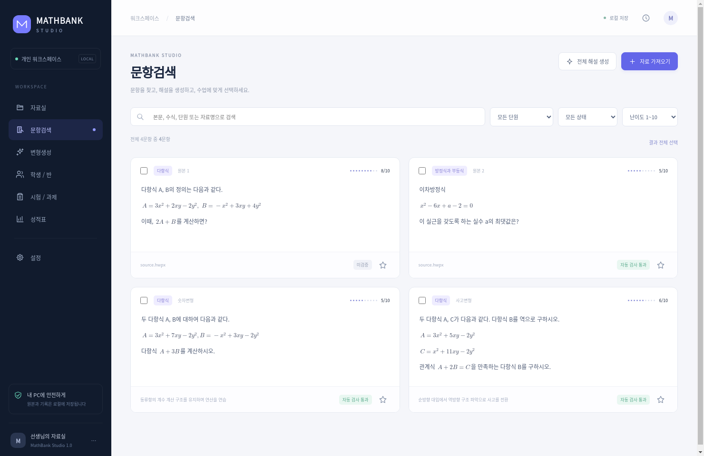

# MathBank Studio



Windows 개인 수학 문제은행을 **빈 프로젝트에서 새로 구현한 독립 프로그램**입니다. 이전 프로그램의 모듈·화면·DB·빌드 산출물을 사용하지 않습니다.

문제 HWPX/HWP → 구조화 문항 → 별도 정답·해설 생성과 검증 → 숫자·사고변형 → 학생별 시험 → PDF/HWPX → 채점·오답 과제·성적표를 로컬 SQLite 자료실에서 연결합니다.

다운로드는 [Releases](https://github.com/harrytim89-hong/harrytim/releases)에서 `MathBankStudio-1.0.0-Windows-x64.zip`을 받으세요. 압축 전체를 풀고 `MathBankStudio.exe`를 실행합니다. Python·한글 설치 없이 일반 PDF 출력과 채점이 동작합니다.

- [한국어 사용 설명](docs/사용설명.md)
- [지원 범위와 검증 한계](docs/SUPPORT.md)
- [새 구현 검증 기록](docs/VALIDATION.md)

개발 실행(Python 3.12):

```powershell
python -m venv .venv
.venv\Scripts\python -m pip install -r requirements.lock
.venv\Scripts\python launch_studio.py
```

Windows 빌드: `./scripts/build_windows.ps1`. 자동 검사: `python -m pytest -q`. 패키지 전체 검사: `MathBankStudio.exe --self-test`.

앱의 새 자료실은 `%LOCALAPPDATA%\MathBankStudio`입니다. `--workspace "다른폴더"`로 분리할 수 있습니다. 원본 시험·정답·학생 DB는 이 저장소와 배포 파일에 포함하지 않습니다. AI 연결은 선택 사항이며 Codex CLI 또는 로컬 Ollama를 명시적으로 선택합니다.
